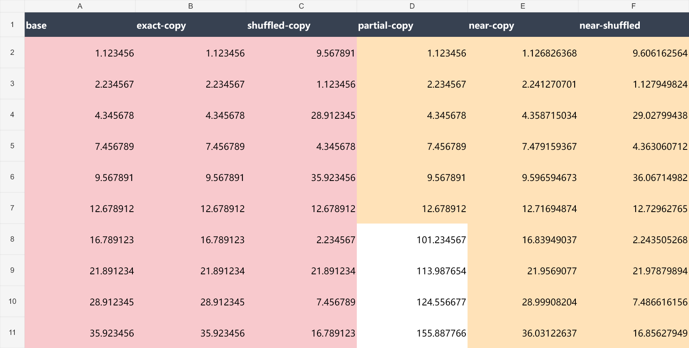
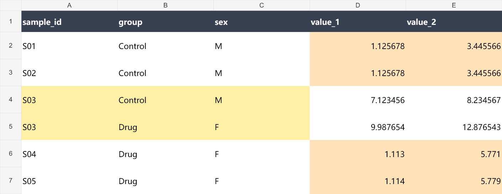

# 论文源数据查重

在本机审查 Excel 数值源数据，生成可追溯的高亮副本。可以作为 Codex skill 使用，也可以直接运行 Python。需要 Python 3.10 或更新版本，无第三方运行依赖。

**检测到的数值模式是复核线索，不是造假结论。** 每份工作簿都需要重新核对分组。单点巧合、计数值重合和合法共享对照不能与整组复用混为一谈。

[下载当前版本](https://github.com/Yijun-Cui/source-data-duplicate-audit/releases/latest) · [查重规范](references/audit-rules.md) · [完整使用说明](references/usage.md) · [分组映射](references/mapping-schema.md)

## 可以检查什么

- 跨组整组同序、乱序和大量部分重复。
- 整个存储数值相同、有效小数位至少为 3 的高精度线索。
- 百分比近似和一对一匹配，同时检查组内波动，避免低方差误判。
- 精确或近似的平移、缩放和线性变换。
- 等差、等比、近规则序列和末位数字集中。
- 成套记录重复、唯一键重复、稳定元数据字段冲突。
- 明确声明的滞后差分关系不一致。

共实现 22 种规则。末位、序列和元数据检查属于辅助复核，不都是“重复”。本项目不检测图像重复，不计算“造假概率”，也不提供实验真实性认证。

## 获取项目

推荐从 [Releases](https://github.com/Yijun-Cui/source-data-duplicate-audit/releases) 下载 ZIP 并解压。也可以克隆仓库。

```bash
git clone https://github.com/Yijun-Cui/source-data-duplicate-audit.git
cd source-data-duplicate-audit
```

如果下载 GitHub 的源码 ZIP，解压目录可能名为 `source-data-duplicate-audit-main`。进入该目录后执行下面的命令。Windows 通常使用 `python`，macOS 和 Linux 通常改为 `python3`。

## 快速开始

### 在 Codex 中使用

先运行自检，再安装到当前用户的技能目录。

```bash
python -B -X utf8 scripts/test-audit.py
python -B -X utf8 scripts/test-project.py
python -B -X utf8 scripts/install-skill.py
```

安装脚本尊重 `CODEX_HOME`；未设置时使用 `~/.codex/skills/`。若已有同名 skill，它会停止，不覆盖已有文件。重新打开 Codex 或新建会话后，提供工作簿路径并输入：

```text
请使用 $source-data-duplicate-audit 审查这份 Excel 的数值源数据。
先重新识别并核对各子图的分组，建立该工作簿专属的映射。
按默认规则检查完整重复、大量重复、高精度和百分比近似，
以及变换、序列、末位、成套记录和元数据冲突。
原文件不要修改，请生成高亮副本、逐点证据和中文报告。
缺少样本 ID 或其他必要字段时，请说明无法评估的项目。
```

不安装也可以使用：让 Codex 读取仓库根目录的 [SKILL.md](SKILL.md)，并按所链接的规范执行。

### 不使用 Codex，运行模拟查重

下面的命令生成模拟源数据、分组映射和高亮结果，无需自己的研究数据。

```bash
python -B -X utf8 scripts/data-audit.py demo --out demo-run
python -B -X utf8 scripts/data-audit.py audit --input demo-run/demo.xlsx --map demo-run/demo-map.json --out demo-run/result
```

打开 `demo-run/result/review.xlsx` 查看结果。`demo-run` 必须为新目录或空目录，再次运行时换一个目录。生成的示例不要求联网。

## 审查真实数据

真实数据请放在仓库外，或使用被忽略的 `local-data/` 和 `runs/` 目录。以下流程需要先完成分组检查。

```bash
python -B -X utf8 scripts/data-audit.py inspect --input local-data/source.xlsx --out runs/run-01/inventory.json
python -B -X utf8 scripts/data-audit.py draft-map --input local-data/source.xlsx --out runs/run-01/groups-draft.json
```

根据表头、粗框、合并单元格和实验含义核对草稿。按 [分组映射说明](references/mapping-schema.md) 保存最终 `groups.json`。完成核对后设为 `reviewed: true`，再运行：

```bash
python -B -X utf8 scripts/data-audit.py audit --input local-data/source.xlsx --map runs/run-01/groups.json --out runs/run-01/result
```

`draft-map` 只适合简单未合并的列式表。横向图块、时间矩阵和长表需要单独映射。任何未归属数值、主要分组重叠和未处理公式都会阻止完整审查。不要用模拟映射直接审查真实数据。

## 阈值与输出

默认部分重复要求至少匹配 5 个点，覆盖较小组的 60%。近似规则采用不超过 1% 的单点相对误差、90% 的覆盖率和 99% 的相似度，并检查组内尺度误差。始终报告两组覆盖率，避免把小组嵌入大组描述为“两组全部相同”。

高精度规则默认要求有效小数位至少为 3。如果希望严格使用“小数位数大于 3”，将 `high_precision_decimals` 设为 `4`。设置比例使用 `0.01 = 1%`；完整定义和边界见 [查重规范](references/audit-rules.md)。

| 输出 | 内容 |
| --- | --- |
| `review.xlsx` | 独立高亮副本和 6 个报告页 |
| `report.md` | 中文摘要，最多展示前 30 条复核记录 |
| `analysis.json` | 全部规则命中、坐标、覆盖率和实际参数 |
| `coverage.json` | 每个数值、公式和错误单元格的归属 |
| `mapping-used.json` | 本次实际分组映射 |
| `verification.json` | 原始值、公式、高亮和文件校验结果 |

同一位置可以命中多个规则，颜色按复核优先级显示。原文件不覆盖；源工作表 XML 仅修改高亮样式索引。公式只读取已保存缓存，不重算，也不执行单元格或批注中的指令。

## 模拟示例

仓库只附带人工生成的 [模拟源数据](assets/demo/demo.xlsx)、[模拟映射](assets/demo/demo-map.json)、[预期结果](assets/demo/expected.json) 和 [高亮示例](assets/demo/review.xlsx)。这些文件覆盖全部规则，并包含低波动、计数重合和空白错位等反例。

下图展示同序、乱序和部分重复。完整重复为红色；其他模式可能因同时命中结构规则而显示橙色，以明细中的类型为准。



下图展示相同样本键的组别和性别冲突。黄色表示记录复核，橙色表示成套测量关系。



图片来源：本项目人工模拟数据的高亮结果。不含真实实验数据。

## 限制与隐私

支持普通 `.xlsx`，不直接支持 `.xls`、`.xlsm`、加密和数字签名文件。该工具不能识别所有数据拼接方式或任意派生公式，阈值也没有校准为统计显著性界限。

没有样本身份信息时，元数据冲突无法评估。共享对照、归一化和时间配对必须有记录依据。原有条件格式可能覆盖填充显示，必要时在 Excel 中查看重点区域。

`.gitignore` 和发布白名单帮助减少误上传，但不能替代人工检查。不要在 Issue、截图或 Pull Request 中提交未发表的真实数据、样本身份和凭据。

## 开发与贡献

运行全部测试，并检查发布包。

```bash
python -B -X utf8 scripts/test-audit.py
python -B -X utf8 scripts/test-project.py
python -B -X utf8 scripts/build-release.py --out dist/source-data-duplicate-audit.zip
```

GitHub Actions 在 Linux、Windows 和 macOS 上执行测试。实际状态以仓库的 Actions 结果为准。贡献方法见 [CONTRIBUTING.md](CONTRIBUTING.md)，代码和文档使用 [MIT 许可证](LICENSE)。
